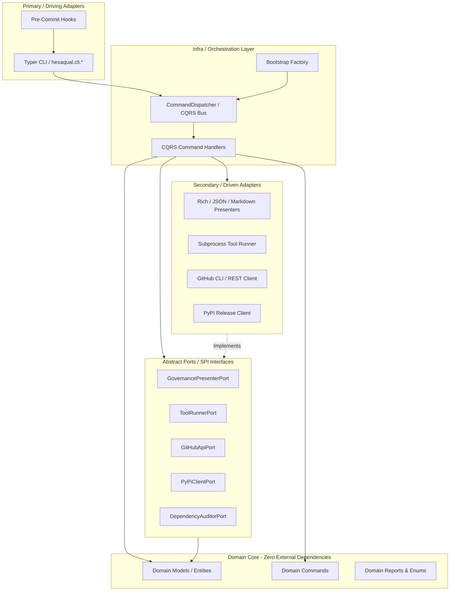

# 🏛️ Hexaqual Architecture & Design Guide

> **Architectural Intent**: Hexaqual is built strictly according to **Hexagonal Architecture (Ports and Adapters)** and **CQRS (Command Query Responsibility Segregation)** principles. It enforces clean architectural boundaries within its own codebase while providing the tooling to enforce them in other Python projects.

---

## 1. Hexagonal Layers & Dependency Flow

The system is organized into concentric layers with strict inbound dependency rules:



### Dependency Rules:
1. **Domain Core (`hexaqual.domain`)**: Pure Python models, command dataclasses, and enums. Contains zero framework dependencies (no CLI, no external tool runners, no subprocess calls).
2. **Ports (`hexaqual.ports`)**: Abstract ABC interfaces defining what the domain and handlers require from the outside world (presenters, runners, API clients).
3. **Adapters (`hexaqual.adapters`)**: Concrete implementations of ports:
   - `adapters/agents/`: Universal `.agents/` guardrail synchronization and drift auditing (`fs.py`, `service.py`).
   - `adapters/code_analysis/`: AST and quality adapters (`all_statements.py`, `test_parity.py`, `import_linter.py`, `pydeps.py`, `docs_drift.py`, `doc_links.py`, `extras_parity.py`, `mutmut.py`, `rope.py`, `sanity.py`, `usage_docs.py`, `coverage.py`, etc.).
   - `adapters/github/` & `adapters/publishers/`: GitHub API (`client.py`, `ci_duration.py`), Dev.to (`devto.py`), and PyPI (`pypi.py`) clients.
   - `adapters/hooks/`: Git lifecycle hook installers and commit-msg validators (`git_hooks.py`, `service.py`).
   - `adapters/presenters/`: Rich, table, JSON, and Markdown presentation formatters.
   - `adapters/runners/` & `adapters/testing/`: Subprocess, testing, dependency, PyPI, and cluster runners plus test event narration.
   - `adapters/openssf.py` & `adapters/workspace.py`: OpenSSF audit and workspace layout discovery adapters.
4. **CLI (`hexaqual.cli`)**: Driving adapters powered by Typer. They parse user inputs, construct domain commands, dispatch them across the CQRS bus, and delegate output rendering to adapters.
5. **Infra (`hexaqual.infra`)**: Plumbing, including the `CommandDispatcher`, decoupled CQRS command handlers (`infra/handlers/`), `openssf.py`, `workspace.py`, and bootstrap wiring (`bootstrap.py`).
6. **Utils (`hexaqual.utils`)**: Shared low-level helpers (`mutation_slicing.py` for AST-weighted LPT mutation slice partitioning).

---

## 2. Directory Layout

```text
src/hexaqual/
├── domain/                  # Pure domain entities, commands, and reports
│   ├── agents.py            # AgentAsset, AgentSyncReport, AgentCheckReport
│   ├── analysis.py          # Complexity and static analysis contracts
│   ├── base.py              # Base Command and DomainModel primitives
│   ├── dependencies.py      # Dependency audit, deptry, pydeps, and extras models
│   ├── docs_drift.py        # Documentation drift models and commands
│   ├── generators.py        # Documentation and diagram generation contracts
│   ├── github.py            # PR summary, check run, and review models
│   ├── governance.py        # Sanity check findings, targets, and reports
│   ├── hooks.py             # Git hook lifecycle contracts
│   ├── imports.py           # Import-linter contract models
│   ├── openssf.py           # OpenSSF badge and scorecard contracts
│   ├── pypi.py              # Release metadata and package distribution models
│   ├── refactoring.py       # Rope refactoring commands and results
│   └── testing.py           # Test execution, mutation, and coverage models
├── ports/                   # Abstract Port interfaces (ABCs)
│   ├── agents.py            # AgentAssetPort
│   ├── analysis.py          # Analysis presenter and runner ports
│   ├── dependencies.py      # DependencyAuditorPort
│   ├── generators.py        # Doc generator and presenter ports
│   ├── github.py            # GitHubApiPort, GitHubPresenterPort
│   ├── governance.py        # GovernancePresenterPort, ToolRunnerPort
│   ├── hooks.py             # GitHooksPort
│   ├── openssf.py           # OpenSsfPort
│   ├── publishers.py        # Article publisher ports
│   ├── pypi.py              # PyPiClientPort, PyPiPresenterPort
│   ├── refactoring.py       # RefactoringPort
│   ├── testing.py           # TestingPresenterPort
│   └── workspace.py         # Workspace discovery port
├── adapters/                # Concrete Port implementations
│   ├── agents/              # Bundled asset sync & drift detection
│   ├── code_analysis/       # AST analyzers, parity, statements, drift, links, mutmut, rope
│   ├── github/              # GitHub HTTP API & CI duration adapters
│   ├── hooks/               # Git hook installers and DCO commit-msg validators
│   ├── presenters/          # Rich, JSON, plain, table, and Markdown presenters
│   ├── publishers/          # Dev.to and PyPI publishers
│   ├── runners/             # Subprocess, testing, dependency, PyPI, and cluster runners
│   ├── testing/             # Test event capture & terminal narrators
│   ├── openssf.py           # OpenSSF badge & Security Scorecard adapter
│   └── workspace.py         # Workspace root and package layout resolver
├── assets/
│   └── agents/              # Bundled universal .agents rules, workflows, and skills
├── cli/                     # Driving adapters (Modular Typer sub-applications)
│   ├── main.py              # Root Typer entrypoint mounting sub-apps + 'version'
│   ├── agents.py            # 'agents' subcommands (sync, check, list)
│   ├── check.py             # 'check', 'sanity', and 'complexity' commands
│   ├── deps.py              # 'deps' subcommands (audit, deptry, linter, linter-generate, pydeps)
│   ├── docs.py              # 'docs' subcommands (usage, drift, links, publish, blog medium)
│   ├── gh.py                # 'gh' subcommands (pr, checks, repo, security, code-scanning, codeql, resolve, ci-duration)
│   ├── hooks.py             # 'hooks' subcommands (install, uninstall, check, commit-msg)
│   ├── mutate.py            # 'mutate' subcommands (run, inspect, plan)
│   ├── openssf.py           # 'openssf' subcommands (audit, propose, checklist, scorecard, scaffold, check)
│   ├── options.py           # Shared '-f/--format' and '-s/--summary' Typer options
│   ├── parity.py            # 'parity' subcommands (test, architecture, extras)
│   ├── refactor.py          # 'refactor' subcommands (alphabetize, rename, extract, move, run)
│   ├── release.py           # 'release' subcommands (build, check, publish, reproducible)
│   ├── statements.py        # 'statements' subcommands (check, fix)
│   └── test.py              # 'test' subcommands (run, bench, boundary, impact, redundancy, fuzz, snapshot, archon, benchmark-report)
├── infra/                   # CQRS bus and orchestration plumbing
│   ├── dispatcher.py        # Synchronous in-process command dispatcher
│   ├── bootstrap.py         # Factory assembling buses with default adapter wiring
│   ├── openssf.py           # OpenSSF orchestration service
│   ├── workspace.py         # Workspace service wrapper
│   └── handlers/            # Decoupled CQRS command handlers (including Hexaflow sanity DAG)
└── utils/                   # Shared helper utilities
    └── mutation_slicing.py  # AST-weighted LPT mutation slice planner
```

---

## 3. Core Architectural Invariants

Hexaqual enforces five non-negotiable quality invariants across both its own codebase and target client projects:

### Invariant 1: Layer Boundary Isolation
- `domain/` must never import from `ports/`, `adapters/`, `infra/`, or external runtime frameworks.
- `ports/` must never import from concrete `adapters/` or `infra/`.
- `adapters/` must never import from `infra/`.
- Driving adapters (`cli/`) only interact with domain commands and dispatchers.

### Invariant 2: 1:1 Test Parity & Symmetry
- Every non-init source module `src/<pkg>/<path>.py` requires a corresponding unit test `tests/unit/<path>/test_<name>.py`.
- Every subdirectory under `tests/unit/` must contain an `__init__.py` file.
- Verified in ~0.01s via `hexaqual parity test`.

### Invariant 3: Alphabetical `__all__` Casefold Integrity
- Every exported symbol in `__all__` lists must be sorted strictly casefold (`casefold()` sorting).
- Duplicate exports are prohibited.
- Verified via `hexaqual statements check` and autofixed via `hexaqual statements fix`.

### Invariant 4: Cognitive Complexity Ceiling
- No function or method may exceed a cognitive complexity score of **25** (measured by `complexipy`).
- Complex handlers must be decomposed into focused private helper functions.

### Invariant 5: Universal Dynamic Workspace Discovery
- Tools never hardcode project names or workspace structures.
- Detects multi-package monorepos (`packages/` or `tool.uv.workspace`) vs single-package standalone repositories.
- Detects example projects (`examples/`) and provides `-e` filtering automatically.

---

## 4. Pre-Commit Quality Pipeline

Hexaqual exposes a streamlined pre-commit hook that replaces multi-tool overhead with a single sub-second execution:

```yaml
# .pre-commit-config.yaml
repos:
  - repo: local
    hooks:
      - id: hexaqual-sanity
        name: hexaqual sanity check
        entry: uv run hexaqual sanity --skip-tests
        language: system
        pass_filenames: false
```

The sanity workflow orchestrates a **3-stage Hexaflow DAG** across workspace targets:

1. **Stage 1 (`static_checks`)**:
   - **Ruff Lint & Format**: Validates formatting and static style rules.
   - **`__all__` Integrity**: Confirms public exports are deduplicated and casefold-sorted.
   - **Test Parity**: Guarantees 1:1 unit test symmetry for workspace packages.
   - **Architecture Diagrams**: Audits `pydeps` dependency SVGs (skippable via `--skip-diagrams`).
2. **Stage 2 (`analysis`)** (depends on `lint`):
   - **Ty Typecheck**: Fast static type analysis.
   - **Cognitive Complexity**: Ensures functions and methods stay $\le 25$.
   - **Deptry**: Detects unused or missing dependencies across package manifests.
3. **Stage 3 (`verification`)** (depends on `typecheck` and `complexity`):
   - **Pytest**: Runs target test suites automatically unless `--skip-tests` is passed.
